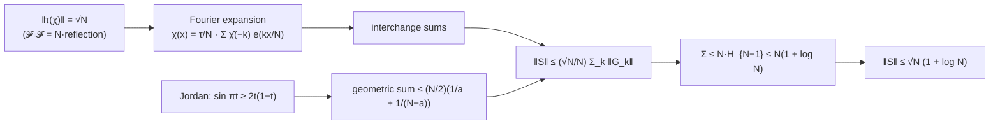

# Pólya–Vinogradov inequality in Lean 4


This repository contains a complete, machine-checked proof of the **Pólya–Vinogradov inequality** (Pólya 1918, Vinogradov 1918) for primitive Dirichlet characters.

## Statement

```lean
theorem PolyaVinogradov.polya_vinogradov {N : ℕ} [NeZero N]
    {χ : DirichletCharacter ℂ N} (hχ : χ.IsPrimitive) (hN : 1 < N) (M L : ℕ) :
    ‖∑ i ∈ Finset.range L, χ ((M + i : ℕ) : ZMod N)‖ ≤ Real.sqrt N * (1 + Real.log N)
```

For every primitive character χ modulo N > 1, every sum of χ over L consecutive integers M, M+1, …, M+L−1 has absolute value at most √N · (1 + log N).

## Kernel check

`lake env lean CheckAxioms.lean` prints:

```
'PolyaVinogradov.polya_vinogradov' depends on axioms: [propext, Classical.choice, Quot.sound]
```

These are Lean's three standard axioms. The proof contains no `sorry`, adds no axioms, and does not assume RH or GRH.

## Proof outline



| Step | Lemma (in `PV/Main.lean`) | Content |
|---|---|---|
| 1 | `normSq_gaussSum`, `norm_gaussSum` | ‖τ(χ)‖² = N for primitive χ (not previously in Mathlib) |
| 2 | `fourier_expansion` | χ(x) = N⁻¹ τ Σ_k χ⁻¹(−k) e(kx/N) |
| 3 | `two_mul_mul_le_sin`, `norm_geom_sum_le` | Jordan-type bound and geometric-sum bound |
| 4 | `sum_inv_val_le`, `sum_inv_neg_val_eq` | harmonic-sum bound ≤ 1 + log N |
| 5 | `polya_vinogradov` | assembly |

## Reproduce

```bash
lake exe cache get
lake build
lake env lean CheckAxioms.lean
```

## References

- G. Pólya, Über die Verteilung der quadratischen Reste und Nichtreste, *Nachr. Ges. Wiss. Göttingen* (1918), 21–29.
- I. M. Vinogradov, Sur la distribution des résidus et des non-résidus des puissances, *J. Soc. Phys.-Math. Univ. Permi* **1** (1918), 94–96.
- H. Davenport, *Multiplicative Number Theory*, 3rd ed., GTM 74, Springer, 2000, Ch. 23.
- The mathlib Community, The Lean mathematical library, *CPP 2020*.

## License

MIT.
